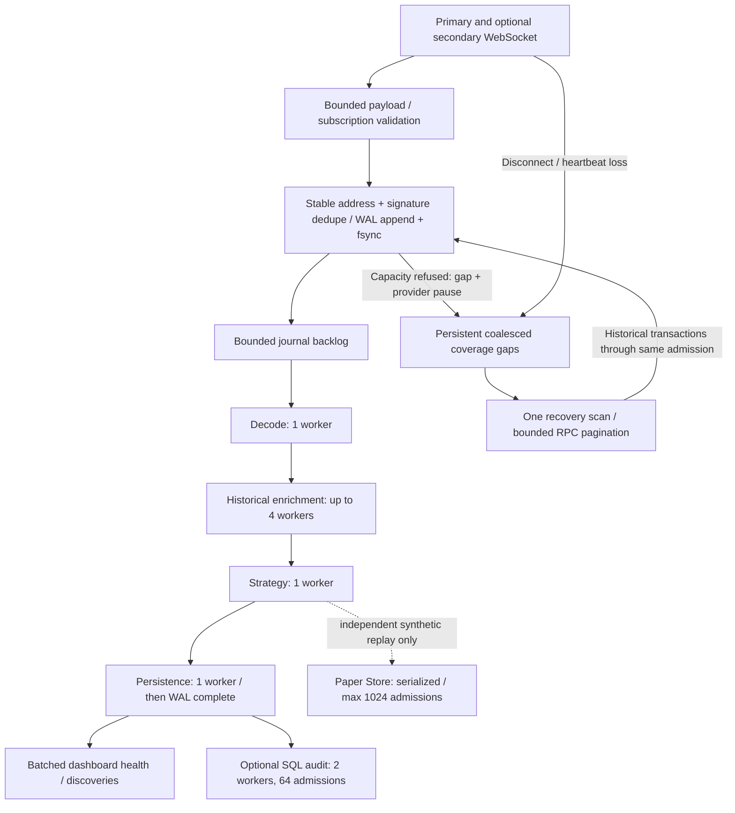

# Phase 2 bounded ingestion and recovery contract

This document preserves the Phase 2 contract and measurements. Phase 3 source monitoring now uses an asynchronous worker WAL, fair scheduling, selected finalized protocol verification and bounded raw rotation; see [the current contract](../phase3/README.md).

The [engineering report](../phase2-engineering-report.md) contains measured comparisons, regressions, tests and remaining issues. Raw JSON and logs in this directory are offline evidence, not a mainnet performance claim. All commands below run source without rebuilding the application. Existing dashboard assets remain unchanged; restart a source server to exercise the implementation. A pre-existing compiled deployment continues using its old code until separately rebuilt/deployed.

## Architecture and ownership



The runtime receipt path validates before durable admission and deduplicates before expensive decoding. A global limit of **128 active flows**, including work waiting at any stage, prevents summed stage capacities from multiplying memory growth. Each stage also admits at most 128 tasks including active workers; defaults are decode 1, enrichment 4, strategy 1 and persistence 1. Stages yield periodically with `setImmediate`. `BoundedStage.trySubmit` explicitly refuses excess work; its promise represents settlement, not admission to an unbounded promise chain.

The monitoring service currently supplies raw persistence and discovery callbacks. Its enrichment/strategy stages are extension boundaries with no automatic live-chain-to-paper connection. Actual risk/strategy/paper timings remain in the existing Engine/Store and synthetic replay API. Missing chain prices or risk evidence never become invented enrichment results. Independent fixture quotes exercise those callbacks in benchmarks/tests only.

A receipt is owned only after `EventJournal.offer` succeeds. The default disk journal has:

| Resource | Default bound |
| --- | ---: |
| Pending identities/payloads (including quarantined) | 10,000 |
| Retained completed identities | 20,000, also reduced for small byte limits |
| WAL/checkpoint bytes | 64 MiB |
| Pending serialized payload budget | half the WAL byte limit, with retry headroom |
| Observation log payload | 256 KiB aggregate; 2,048 lines, each ≤65,536 characters |
| Work execution attempts | 3; exponential delay capped at 1 s |
| Simultaneous runtime providers | 2 |
| Coalesced coverage gap records | 1 per verified program, currently 4 |
| SQL audit admissions / workers | 64 / 2 |
| Store pending transactions (active + waiting) | 1,024 |

Journal payload maps, timing maps, flow sets, retained identities, decoder cache and gap metadata are finite. Configuration bounds are available through constructors; environment exposes the journal path and provider endpoints, not arbitrary unaudited queue tuning. Completed identity metadata does not retain event payloads. Histograms retain 10,000 samples each under fixed metric names.

Pending work beyond the active-flow cap stays journaled and is marked deferred. Full journal admission records `journal-capacity`, a known refusal and a slot interval; the service stops providers and resumes them below half pending capacity. Backfill subsequently repairs recoverable refused work. Refused admission is not a permanent-loss claim. Journal I/O failure fails ingestion visibly (`fatal`/`degraded`); do not assume a rejected receipt is safely persisted. Invalid receipts have dedicated counters. Work failing all attempts stays quarantined, consumes bounded journal capacity and appears in status; there is no automatic deletion or unsafe retry loop.

## Stable identities and replay semantics

Identity is `verifiedProgramAddress:transactionSignature`. It excludes provider, arrival order and slot, so overlap, history and reconnect share ownership. Pending and retained-completed maps survive restart. On completion eviction, a conservative per-program slot floor rises. Unknown events at or below that floor are explicitly rejected with `outside-dedupe-window` and a gap, rather than potentially replayed into strategy. Legitimate very late events may be refused. This is a finite ownership horizon, not an eternal exactly-once promise.

WAL entries persist work before processing and completion after the persistence callback. A crash before acknowledgement replays pending work. Callback side effects and WAL acknowledgement are **not a single cross-system transaction**. Stable identity must be propagated into idempotent consumers. The existing paper engine's persisted `seen` list retains 10,000 IDs; the crash test confirms no second buy/fee for the tested retained ID. Raw JSONL may repeat a line after a crash and optional SQL audit is best effort. An arbitrarily old replay after paper `seen` eviction is not guaranteed safe for duplicate trading; read-only runtime does not trade.

The journal uses a PID lock and stale-process check to prevent two local writers. It truncates an incomplete final line and rejects malformed complete records. Compaction writes a new checkpoint then renames it. File fsync is default; `durable:false` is a constructor option for explicit tests, not the runtime default. Parent-directory fsync and arbitrary power-loss consistency are not implemented. Existing Store snapshots retain their original temp-file/rename persistence, without file fsync. Never use the journal as a funded execution ledger.

## Reconnection and bounded backfill

A WebSocket disconnect records the last durable program anchor and an overlap interval. Silent sockets are detected by ping/pong heartbeat (15 s by default); the existing bounded reconnect backoff remains. Monitor generation guards reject stale socket messages. Real sockets enforce payload size and a 10 s handshake timeout. Provider overlap shares central dedupe. A fresh secondary's initial subscription does not infer a false gap from activity already received on the primary. Restart with retained anchors and reconnect both request recovery; an unresolved gap preserves its original anchor even if new live events arrive.

Each recovery scan:

1. Persists an attempt before its first RPC, captures a confirmed `getSlot` upper boundary and refuses a provider behind its trusted anchor.
2. Determines a lower boundary using the persisted gap/anchor and 32-slot overlap, constrained to a 10,000-slot window. Window truncation remains partial coverage.
3. Calls `getSignaturesForAddress` newest first, advancing `before`, with up to 100 signatures/page, 20 pages and 2,000 in-window signatures by default. It validates descending order and cursor progress, continues past all signatures at the lower slot, and requires a row strictly below that slot plus the trusted anchor to establish the requested window.
4. Retrieves missing transactions with at most four concurrent `getTransaction` calls. It skips journal-owned identities before retrieval. Parsed transaction signature, slot, program account and logs must match; failed transactions remain failed observations. Existing verified decoders process admitted historical logs exactly as live logs.
5. Honors WAL backpressure between RPC batches. A scan waits for admitted work to settle before claiming provider-window coverage. Quarantine, data absence, refusal, caps, missing anchor/boundary or a gap expanding during a scan prevents a recovered result.

RPC semantics follow Solana's [getSignaturesForAddress documentation](https://solana.com/docs/rpc/http/getsignaturesforaddress) (newest-first signatures and `before` pagination) and [getTransaction documentation](https://solana.com/docs/rpc/http/gettransaction) (`null` can mean unavailable/not confirmed, not proof no transaction occurred). Calls use confirmed commitment and explicitly support legacy/v0 transaction retrieval. `minContextSlot` is not used as a historical-slot filter. These are provider responses, not proofs that a provider indexed every chain event.

Default scan deadline is 30 s. HTTP calls abort after 5 s and response bodies are streamed with a 4 MiB bound. Each RPC gets two retries; 429/5xx and supported transient RPC errors retry with backoff. `Retry-After` is honored only if within the scan deadline and 5 s maximum wait; larger values terminate the attempt explicitly. A final in-flight HTTP call or pipeline drain can settle after the nominal scan deadline, so this is a bounded work budget, not a hard real-time cancellation guarantee. A single coordinator scan runs globally, with at most four coalesced program requests and three automatic cycles per unresolved gap. First-RPC failure consumes a cycle too.

Gap status is `pending`, `recovering`, `partial`, `recovered` or `unrecoverable`. The coordinator makes a failed scan retryable until the third cycle, then records `cycle-budget-exhausted:<reason>`. Missing HTTP RPC configuration leaves explicit incomplete gaps; it does not report recovery. An anchor is the greatest durably observed slot/signature, **not** a contiguous chain checkpoint. A first-ever fresh subscription has no trusted pre-start checkpoint; pre-start missed events are unknown. There is no fork rollback/finality reconciliation or independent provider-index verification.

## Runtime API and operations

Existing API contracts, token/origin checks, risk filters, mark freshness, accounting and live-mode rejection remain. Additive endpoints require the same bearer authentication:

| Endpoint | Meaning |
| --- | --- |
| `GET /api/ingestion` | Provider readiness, in-flight/bounded journal state, quarantined counts, anchors/floors, decoder coverage, gaps and fatal status |
| `POST /api/ingestion/recover` | Request recovery for optional `{ "program": "pump" }`, or all configured programs; reset automatic cycle budget |
| `GET /api/state` | Existing fields plus additive `ingestion`; retains `latencies`, `telemetry` and discoveries |
| `GET /api/metrics` | Existing collector with new stage/recovery counters, gauges and histograms |

Recovery requests are read-only and return acceptance, not coverage completion. Diagnose the existing gap reason before resetting budgets. Quarantined work needs operator investigation; manual history recovery does not bypass decoder checks or automatically unquarantine failed work. No new wallet permission, signing endpoint or funded route exists.

Set optional `SOLANA_SECONDARY_WS_URL` for overlap. `INGESTION_JOURNAL_PATH` defaults to `data/server-ingestion.wal` (server) or `data/monitor-ingestion.wal` (CLI). Each process needs separate journal/raw/state paths. Stop processes before backup or raw log rotation. Preserve the WAL together with state; never delete a live lock or discard pending work to clear an alert. Raw JSONL files remain unbounded on disk. SQL audit refusal/failure is counted separately from raw-event persistence. Health batching changes when counters reach the dashboard (up to 250 ms plus Store wait), not paper balance transitions.

## Metrics and measurement boundaries

`performance.now()` supplies process-local monotonic durations. Existing wall-clock timestamps remain for quotes, UTC accounting, retry schedules, deadline budgets and display. No duration subtracts a wall timestamp from a monotonic timestamp. WAL restart starts new local latency spans; it does not compare monotonic origins from different processes.

| Metric | Boundary |
| --- | --- |
| `ingest.receipt_ms` | Observation validation, central identity lookup and durable admission; includes synchronous WAL/fsync |
| `ingest.<stage>.queue_wait_ms` | Admission to a particular stage until its worker begins |
| `ingest.<stage>.processing_ms` | Stage worker execution/settlement, including awaited work |
| `ingest.<stage>.end_to_end_ms` | Local receipt/resumption until that stage settles; nested spans overlap |
| `ingest.end_to_end_ms` | Local receipt/resumption through raw persistence and journal acknowledgement |
| `ingest.in_flight` | Global active flows, ≤128 by default |
| `ingest.<stage>.pending/queue_depth/in_flight` | Total admitted / waiting / active tasks, with current and peak gauges |
| `ingest.offered/completed/duplicates/deferred/deferred_completed` | Receipt offers, acknowledged completions, owned duplicate receipts and WAL deferrals |
| `ingest.unpersisted/unrecoverable_offers/invalid_observations/quarantined` | Explicit refusal/failure classes, not a universal chain-loss counter |
| `ingest.recovered/restart_completed` | Completed historical-origin work / completed work resumed from disk |
| `backfill.*`, `rpc.*` | Scan outcomes, unavailable data, retries, instrumented read calls/errors and latency |

The timing map is bounded to pending journal identities. Journal backlog age appears in receipt-to-completion latency but is not a stage queue-wait sample. Journal pending/byte counts are status values; a peak pending-journal gauge is not currently collected. Legacy `monitor.*`, Engine, risk, strategy, paper and Store metrics remain. Central dedupe time is part of receipt admission, whereas `monitor.deduplication_ms` covers the legacy/default monitor dedupe option. SQL audit is outside primary ingestion completion. The Stage and Store spans are nested; do not sum them.

## Reproduce recorded comparisons

Use existing dependencies; there is no rebuild. The archive contains Phase 2 **before** source, strategy and package metadata only, with no dependencies/keys. Use an empty extraction directory.

```sh
mkdir -p /tmp/mintbot-phase2-before
# Skip extraction if this directory already holds the recorded baseline.
tar -xzf docs/phase2/before-source.tar.gz -C /tmp/mintbot-phase2-before
ln -s "$PWD/node_modules" /tmp/mintbot-phase2-before/node_modules
npm test
npm run typecheck

# Original comparable Phase 1 harness, three independent repetitions:
npm run benchmark -- --source-root /tmp/mintbot-phase2-before --events 1000 --runs 3 --output docs/phase2/before.json
npm run benchmark -- --events 1000 --runs 3 --output docs/phase2/after.json

# Extended same-harness comparisons, including architecture ablation:
npm run benchmark:ingestion -- --source-root /tmp/mintbot-phase2-before --output docs/phase2/workloads-before.json
npm run benchmark:ingestion -- --adapter legacy --output docs/phase2/workloads-optimized-legacy.json
npm run benchmark:ingestion -- --output docs/phase2/workloads-after.json
npm run benchmark:decoder
npm run benchmark:phase2-report
```

Run benchmarks sequentially without competing tests or servers. The extended harness runs each workload once in fixed order and uses synthetic Pump logs (one repeated mint), independent synthetic paper quotes, saved swap-inspection fixtures and mocked RPC faults/history. The decoder-specific harness separately shows repeated-mint locality and cold unique-mint misses. Only durable-burst includes actual disk I/O; its new WAL changes durability and costs throughput. Stage timing is not chain detection or landing latency. Stress/saturation baseline refusals change the completed sample population; never compare their successful-event percentiles as equivalent work.

The report generator validates environment/harness compatibility, conservation and state integrity. It does not silently regenerate measurements. Checkpoint JSON files `store-only.json` and `store-decoder.json` record focused chronological measurements before subsequent hardening. Final source and baseline manifests plus test logs identify the measured versions. All original 50 tests remain, with deterministic bounded-worker/dedupe/recovery mocks, actual local HTTP/WebSocket integration, forced SIGKILL replay and a final 72-test pass. No performance threshold is asserted in tests.
