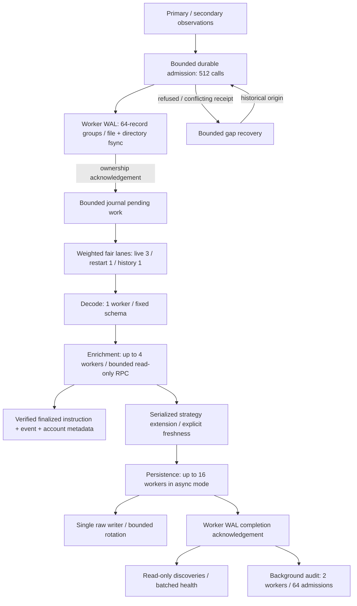

# Phase 3 ingestion, durability and verified metadata

See the [engineering report](../phase3-engineering-report.md), [WAL design](wal-durability.md) and [protocol coverage matrix](protocol-coverage.md). The original application, dashboard, paper engine, existing API fields and Phase 1/2 harnesses remain. Live mode still fails startup. Source checks and offline benchmarks require no application rebuild.

## Queue architecture



There are at most 128 processing flows across all stages. All lane maps are subsets of pending journal work. New accepted live work receives a share after current in-flight work settles, even when a large historical backlog exists. Restart and history retain nonzero shares and eventual service when workers make progress. Fairness is by admitted event, not wall-clock CPU time; active RPC calls are not preempted. RPC timeouts/retry budgets remain finite. A stalled user-supplied extension callback cannot be made safe by pretending to cancel its side effects.

Runtime chain observations remain read-only. Strategy callbacks in the offline harness use separate synthetic quotes; neither protocol decoding nor an event's label establishes price/liquidity/risk evidence. Verified discovery output always has `executionEligible:false`.

## Freshness and fork policy

Each processing context carries actual receipt wall time, event slot, origin (`live`, `history` or `restart`) and the last RPC-sampled chain head, or explicit `null`. No missing chain timestamp is replaced with detection time. Server/CLI head sampling is bounded to one in-flight call, every five seconds. Recovered and restarted events remain labeled as such even if their processing begins now.

Paper strategies accept an optional `freshness` policy: `maxReceiptAgeMs`, `maxSlotLag`, `allowHistorical` (default false) and optional `maxEventAgeMs`. Verified paper inputs require freshness by default (5,000 ms receipt age / 8-slot lag); synthetic legacy fixtures retain their existing behavior unless supplied freshness metadata. Unknown head, future/old receipt, excessive slot lag, disallowed origin or a required but missing event timestamp rejects entry. This policy adds a guard to existing risk rules; it does not remove a token-safety or spending check. There is no automatic verified-discovery-to-paper conversion.

Same-identity slot/log/success conflicts become `fork-or-provider-conflict` gaps and never a second strategy callback. Pending and newly completed IDs carry a content fingerprint; old Phase 2 completions may lack it and still detect slot disagreement. Finalized transaction retrieval must match the receipt's slot/signature before producing verified discovery metadata. Unknown or incompatible layouts remain explicit verification issues; unavailable finality/RPC data retries and can quarantine work. Already committed paper history is not automatically rolled back on a later fork report. Funded fork compensation/finality reconciliation remains outside scope.

## Status, metrics and storage

Authenticated `GET /api/ingestion` and `/api/state.ingestion` retain Phase 2 fields and add writer failure/durability details, pending peak, oldest pending age, WAL bytes, unacknowledged record/byte occupancy, disk availability, bounded verified discoveries/issues, raw-storage usage and occupancy/disk alerts. Existing `/api/metrics` adds acknowledgement counts, group sizes and worker append/sync timings. WAL byte counts describe the last acknowledged worker state. Monotonic duration samples never mix with persisted wall-clock receipt-age values.

Raw observation/discovery files rotate at 16 MiB each, retaining four archives by default, through a bounded 64-admission single writer. Before deleting an archive, a retention manifest records cumulative bytes/files removed and conservative removed-slot coverage, then fsyncs and renames that manifest and syncs its directory. Rename-before-manifest crash orphans are discovered and adopted. Previously tombstoned files are removed on restart without being counted twice. Unknown recovered archive boundaries remain explicitly unknown. Retention only applies to the raw writer's own numbered archives; it never deletes the work WAL or unresolved gaps. Legacy oversized raw files may remain as oversized archives during migration; no data is silently truncated to fit a new bound.

Raw JSONL remains an audit, not an exactly-once ledger. Its writes do not independently promise fsync. WAL completion follows the configured primary persistence callback; side effects and WAL are separate transactions. Back up state, WAL, raw files and retention manifests with monitoring stopped. Use one process per journal/raw/state set. Monitor disk space; do not delete a live PID lock or pending WAL to clear an alert.

Defaults are intentionally bounded in source constructors. Optional provider/journal environment settings remain compatible. `SOLANA_SECONDARY_WS_URL` shares stable ownership with the primary. Chain verification uses native bounded JSON RPC for parsed legacy/v0/v1; old SDK inspection helpers remain separate and are not claimed to support arbitrary future versions. Runtime verification can be disabled only through a trusted service constructor option for controlled tooling; no HTTP switch bypasses trading safety.

## Offline evidence and reproduction

With the repository's installed dependencies:

```sh
npm test
npm run typecheck

# Extract into an empty directory, then link the unchanged installed dependencies.
mkdir -p /tmp/mintbot-phase3-before
tar -xzf docs/phase3/before-source.tar.gz -C /tmp/mintbot-phase3-before
ln -s "$PWD/node_modules" /tmp/mintbot-phase3-before/node_modules

node --import tsx scripts/profile-journal.ts --source-root /tmp/mintbot-phase3-before
node --import tsx scripts/journal-benchmark.ts --before-root /tmp/mintbot-phase3-before
node --import tsx scripts/phase3-benchmark.ts --before-root /tmp/mintbot-phase3-before --runs 3

# Retained original harnesses, unchanged:
npm run benchmark -- --source-root /tmp/mintbot-phase3-before --events 1000 --runs 3 --output docs/phase3/phase1-before.json
npm run benchmark -- --events 1000 --runs 3 --output docs/phase3/phase1-after.json
npm run benchmark:ingestion -- --source-root /tmp/mintbot-phase3-before --output docs/phase3/phase2-before.json
npm run benchmark:ingestion -- --output docs/phase3/phase2-compatible-after.json
npm run benchmark:soak -- --seconds 30 --rate 200
python3 scripts/phase3-report.py
```

Do not extract over an already prepared baseline directory or add a second dependency symlink. Run performance tools sequentially, with tests/other benchmarks stopped. The new harness randomizes jobs with a recorded seed across three repetitions and requires equal offered/completed populations and valid paper accounting. Unique-mint and repeated-mint fixtures each contain 10,000 events. Durable burst includes real WAL/Store/raw I/O; the other pipeline fixtures are in memory. Worker startup, fixture generation and module loading are excluded and must not be read as zero cold-start cost. The finite sustained fixture is not a multi-hour production endurance test.

Recorded launch replay uses four distinct finalized public creation captures repeated 100 times per run. That is a decoder workload, not 400 independent chain launches. SIGKILL/restart, unavailable/slow provider, ENOSPC, malformed data and fork conflicts have deterministic regression coverage. ENOSPC/corruption tests are safety/failure experiments rather than throughput improvement claims.

## Optional public or dedicated read-only run

The collector needs Python 3 and the optional `websockets` package (both 10.x and newer import layouts are supported), plus Node/tsx for local Pump decode replay. It runs only with explicit `--run`:

```sh
python3 scripts/mainnet-readonly.py --run --public --seconds 15 --max-observations 500
# For an authorized dedicated provider, export SOLANA_RPC_URL and SOLANA_WS_URL,
# then omit --public. Keep credentials out of command-line arguments and reports.
```

The collector allows only `getSlot`, `getSignaturesForAddress`, `getTransaction` and log subscriptions. It limits message size/queue, total capture bytes, observation count, deadlines and reconnect attempts. It forces one reconnect at half the time or observation budget if possible, measures acknowledgement time and samples finalized retrieval/history after capture. Provider identity is recorded by hostname, not credential-bearing URL.

This is an independent bounded transport/RPC observation experiment, not a mainnet benchmark of paper fills or the runtime WAL. Signed slot lag uses a pre-window head snapshot and can be negative when that head sample is older than the receipt. It is not converted to milliseconds. Sampled missing receipts/page caps do not prove exhaustive coverage or permanent loss. The JSON labels the retrieval sample, distinct-mint source, unavailable data and incomplete history. No precise chain event-to-receipt latency, profitability or first-block claim is made.


The separate `benchmark:soak` tool exercises durable observation-only ingestion for a configured wall time (default 30 s), with paced cohorts, a fixed 10,000-event cap, bounded retained measurement maps and no raw/Store/market-data claim. Its after-only health result is not a before/after speedup. Re-fetch the exact recorded signatures and later finalized account evidence into a separate directory with `python3 scripts/capture-fixtures.py --run`; the output must be revalidated against the pinned layouts if accounts/programs have changed.


Public-provider scope: the Python collector completed a real observation/reconnect/RPC sample. A direct Node RPC probe timed out in this environment, so end-to-end public-provider operation of the Node verifier is not claimed. Its local HTTP/WebSocket integration and finalized capture replay passed. Check provider transport access on the deployment host before relying on online verification; failures stay explicit and cannot authorize a launch entry.
