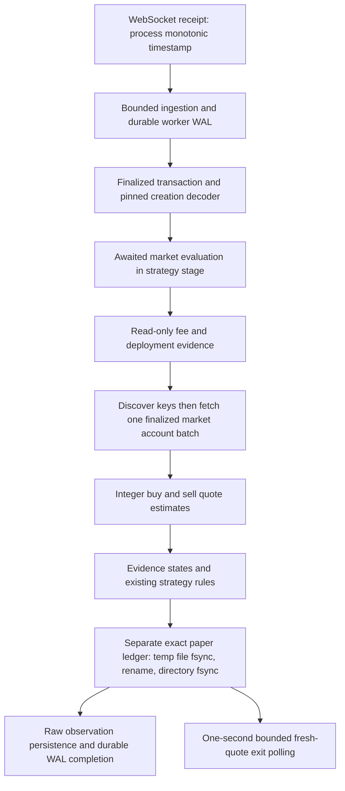

# Phase 4: account evidence and real-market paper research

Live mode remains unavailable. `REAL_MARKET_PAPER=false` is the default. The existing dashboard and synthetic replay keep their original ledger and deterministic fill model. The separate market ledger is exposed through authenticated APIs; the existing dashboard does not render its portfolio.

## Enable the separate paper ledger

Configure `API_TOKEN`, `SOLANA_RPC_URL`, `SOLANA_WS_URL`, `MONITOR_PROGRAMS`, and:

```dotenv
MODE=paper
REAL_MARKET_PAPER=true
MARKET_PAPER_STATE_PATH=data/market-paper-state.json
MONITOR_PROGRAMS=pump,pumpswap,raydium-cpmm,meteora-dlmm
```

Run the existing source server:

```sh
node --env-file=.env --import tsx src/server.ts
```

The ledger starts stopped, including after restart. Send authenticated JSON `{"action":"start"}` to `/api/market-paper/control` to enable its paper decisions. The existing `/api/control` start controls synthetic replay; its **stop and kill also stop market paper**. Market reset requires the global kill switch to be reset first. Settings updates require both modes stopped and update both strategy copies.

| Authenticated API | Behavior |
| --- | --- |
| `GET /api/market-paper/state` | Exact integer ledger, positions, trades, last 200 evidence reviews, telemetry |
| `POST /api/market-paper/control` | `start`, `stop`, `kill`, `reset` for the separate ledger |
| `POST /api/market-paper/sell/:id` | Full-position exit with newly retrieved state and sell quote; no supplied price or quote accepted |
| `GET /api/state` | Existing synthetic dashboard state plus brief market-mode status |
| `GET /api/metrics` | Existing telemetry plus `market.*` series |

No HTTP route accepts arbitrary launch evidence. Only the finalized creation verifier feeds the awaited ingestion strategy callback. The standalone monitor CLI remains a read-only discovery tool. Existing Compose configuration does not forward the new environment variables; source execution above is the validated integration path. No container or application rebuild was performed for this phase.

## Architecture and ownership



Market admissions are bounded at 32, with two workers; existing ingestion strategy concurrency remains one. Durable pending ownership stays in the existing WAL. Market-history caches/reviews retain 200 entries, holder enumeration is capped at 20 token accounts, batches at 32 accounts and RPC responses at 4 MiB with a five-second deadline. Unsupported/risk-rejected market opportunities are terminal, persisted reviews, not automatic price retries. A later launch requires a new verified event identity; a duplicate cannot reopen a position. Persisted paper identities retain the existing 10,000-ID window, with the WAL's existing finite dedupe floors and gap semantics unchanged.

The market ledger uses a single-writer lease. Existing synthetic Store persistence remains unchanged by default; the optional durable Store path fsyncs both file and directory. If publication succeeds but a later durability/validation step fails, that Store refuses further writes until restart and inspection. Market positions cannot use synthetic `mark`, `sell`, timer exits, or ingestion. Financial amounts are bigint/string atoms; existing numeric portfolio fields are derived display values. No signer, secret key, submission method, funded swap or unsigned swap construction is added. The one-signature fee message is read-only and never signed or submitted.

## Supported account and quote scope

All creation variants remain restricted to the [Phase 3 whitelist](../phase3/protocol-coverage.md). These adapters further restrict market eligibility:

| Venue | Supported evidence and quote scope | Recorded evidence / restrictions |
| --- | --- | --- |
| Pump.fun | Native SOL, 166-byte curve; 1045/1088-byte global; versioned 2512/4073/4097-byte fee config; actual mint/custody, real and virtual reserves, dynamic fee tiers and creator override; integer buy and sell estimates | Recorded Mayhem curve quotes match official SDK. Mayhem uses actual mint supply for fee selection; burns are allowed with supply no larger than curve creation supply. Completion, cashback, holder rewards, editable creator fees, depth/non-SOL routes and unknown lengths rejected. Actual SOL custody must cover real reserves and fee buckets. |
| PumpSwap | Base-token/WSOL, strict observed pool prefixes through 301 bytes, global/fee config, canonical-vs-flat tier selection, positive virtual quote reserves, stored fee buckets, LP/protocol/creator fee rounding | Both recorded quotes match official SDK. Liquidity excludes virtual SOL; sell custody excludes accumulated fees. Paused, Mayhem, cashback, holder reward, editable fee and unsupported modes rejected. |
| Raydium CPMM | Exact 637-byte pool and 236-byte config; canonical pool/config PDA; mint/vault program and decimals; live Clock/open time; fee liabilities removed; trade and creator fees on input/output in the applicable direction | Recorded pool has one spendable lamport and its sell route fails. Protocol/fund allocations split the trading fee and are not added a second time. Positive creator-fee math is covered by a synthetic unit model, not a liquid real-chain execution fixture. |
| Meteora DLMM | 904-byte pair v1, bin arrays v2; X-token/WSOL; permissionless activated ordinary modes; dynamic volatility fees, input-only/only-Y collection, integer Q64 prices; full traversal within active and adjacent two bin arrays | Recorded arrays contain no usable two-sided inventory and are rejected. No partial fills, limit-order inventory, activation variants, opposite mint orientation or traversal beyond verified arrays. Sixteen synthetic vectors independently match retained pinned upstream BN helpers; no liquid real-chain fill is claimed. |

Quotes have `kind=account-state-estimate`. They are finite-size reserve/bin calculations, **not indicative spot prices, transaction simulations, or execution guarantees**. Indicative supply-times-reserve-ratio market cap is separately identified and tested against integer strategy thresholds. All-in spot-to-quote shortfall includes pool fees and is conservatively limited to 500 bps each way.

Creation signature, original launch ID/ordinal, event slot, creation commitment, verifier provider, market provider/context, schema revision, account owners and SHA-256 digests, selected fees, decimals, reserves, quote amounts and expiry are retained in evidence reviews. Reviewed deployment-slot pins are checked for the venue and external Pump fee program. A changed loader, deployment slot, layout or account relationship fails closed. Deployment headers are not an ELF hash or a proof of historical program semantics.

## Evidence and safety

Every signal has `verified`, `unknown`, `stale`, or `failed` status, reason and available slot. Authorities must be disabled. Only legacy tokens or metadata-only Token-2022 mint extensions are supported; transfer fee/hook, nontransferable, confidential, default-state, permanent-delegate and unrecognized extensions fail closed. Vaults must be initialized, unfrozen, undelegated and under the verified authority; only ImmutableOwner account extensions are accepted.

Mandatory entry evidence includes token safety, complete bounded owner concentration, actual liquidity, buy and sell routes, impact, identity, finalized creation verification, freshness, deployment and fresh network fees. Owner concentration requires full enumeration followed by same-market-bank token-account reads whose balances reconcile exactly to mint supply; protocol custody is excluded from circulating supply. The largest aggregated owner must have at most 20%. Multiple owner keys under common beneficial control cannot be established and are not described as independent people. Largest-account sampling cannot satisfy this check.

Creator history, volume history, momentum history, and first-observation liquidity changes remain explicitly unknown. Creator history is not a configured mandatory signal; verified creation identity and configured creator lists still apply. Strategies requiring positive volume or momentum cannot enter. Entry delay is checked once at review; a candidate still waiting for its delay is rejected, and deferred market-entry rescheduling with a fresh quote is not implemented. The original synthetic delayed-entry scheduler remains unchanged. Subsequent in-process snapshots report liquidity changes; this is not an exhaustive historical rug-pull scan. Same-slot account conflicts and slot regression are rejected. Cross-provider quorum and historical liquidity/creator attribution remain incomplete.

Fast-launch entry requires live origin, receipt age and block age at most 5 seconds, slot lag at most 8, and market context within 8 slots of the event. Historical/restarted discoveries are rejected before requesting market data. Quotes expire after 1500 ms by both wall and process-monotonic clocks, checked again inside the serialized paper decision. Receipt monotonic timestamps are non-enumerable and never restored as current clocks. Finalization can exceed the five-second policy; rejection is expected and **live fast-launch entry viability has not been demonstrated**.

## Fill model and limits

Buys debit the entire SOL budget plus sourced network estimates and conservative new-account rent, crediting only quoted minimum token output. Pool fees and finite-size price impact are already included in quotes. Sells fetch new state for the full exact token holding and credit minimum SOL proceeds less network costs. Entry cost basis and exit rules include network/rent costs; network costs must leave positive estimated sell proceeds. Unavailable/stale exits retain the position and increment the existing failure circuit. The global and market kill switches block exits under the original kill policy.

Base fee comes from `getFeeForMessage` on an unsigned one-signature representative message. Priority fee uses recent address-specific micro-lamport/CU p75 with an **assumed 200,000 CU**. Rent is read for a conservative **assumed 182-byte account**, expensed on entry and not refunded. Actual swap CU, account creation, execution failure, rent recovery, competing fills, MEV, transaction landing and hypothetical paper reserve changes are not simulated. These limitations remain funded-trading blockers.

## Reproduce verification and measurements

```sh
npm test
npm run typecheck
npm run benchmark:market-reference
npm run benchmark:market
# Restore the preserved Phase 3 baseline, then link installed dependencies:
mkdir -p /tmp/mintbot-phase4-before
tar -xzf docs/phase4/before-source.tar.gz -C /tmp/mintbot-phase4-before
ln -s "$PWD/node_modules" /tmp/mintbot-phase4-before/node_modules
npm run benchmark:phase4 -- --before-root /tmp/mintbot-phase4-before --runs 3
```

Snapshot replays do not measure network latency. The reference-vector script runs retained upstream helpers in a restricted local VM; it does not install an SDK or contact mainnet. Pump/PumpSwap reference checks were separately executed with pinned official packages installed only under `/tmp`; their inputs, package integrities and output records are retained here. Account fixtures are later finalized snapshots, not reconstructed launch-time balances, and are never treated as fresh live opportunities.

To deliberately capture new read-only evidence, run `python3 scripts/capture-market-fixtures.py --run --venue pump` (or another listed venue). It overwrites that recorded fixture, so historical expected values/reference outputs must be refreshed and reviewed together. It never refreshes production quote timestamps. The native transport probe is `node --import tsx scripts/phase4-readonly-probe.ts`; inspect its result instead of inferring runtime connectivity from Python captures.

See the [engineering report](../phase4-engineering-report.md) for actual test counts, measured values, regressions and incomplete acceptance criteria.
