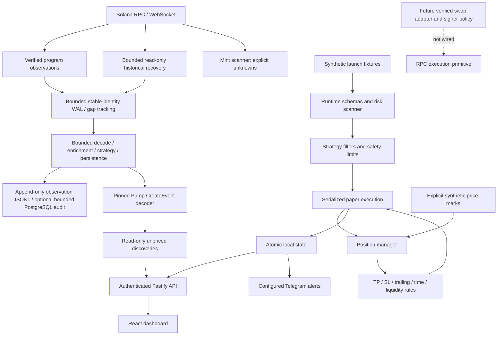
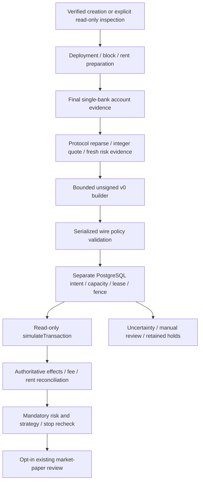

# Architecture and design contracts



By default, real observations are not converted to priced launch opportunities. Phase 4 adds a separate opt-in evidence pipeline described below. The decoder cannot establish executable prices or route permissions. The synthetic pipeline validates accounting/control behavior. `source` distinguishes fixtures from verified evidence; setting a string does not authenticate arbitrary callers, so no generic HTTP ingest route exists.

## Technology choices

| Choice | Reason | Limit |
|---|---|---|
| Strict TypeScript + Zod | Shared explicit contracts and runtime checks | Schema validation does not establish truth or provenance |
| Node/Fastify | Small authenticated local API and fast iteration | Not benchmark evidence for HFT; Node 22 recommended |
| React + Vite + CSS | Lightweight operator dashboard and static build served by backend | Suggested Next.js/Tailwind were not required; no SSR needed |
| web3.js 1.x / SPL SDK | Official existing instruction/mint decoding and fixture compatibility | Legacy dependency advisories remain; migrate before funded release |
| Atomic JSON state | Testable single-process paper snapshots with rollback on errors | No multi-worker ownership, fsync guarantee or permanent full history |
| PostgreSQL event audit | Optional structured public observations/events; supplied relational schema | Audit inserts are not atomic with paper state; failure explicitly returned |
| Optional Redis profile | Infrastructure placeholder for future durable queue/cache | Runtime deliberately does not depend on or claim Redis usage |
| Docker Compose | Reproducible local app, database and volumes | Docker execution must be validated separately; no external hosting claim |

No Rust component is introduced without benchmark evidence of a meaningful need.

## Module contracts

`src/model.ts` defines the full persisted paper state, launch, position, trade and strategy schemas. Nonfinite input, malformed state and unsupported execution modes fail closed. Exactly one strategy is active; launch, pool, momentum and delayed kinds share safety controls. A bounded persisted queue holds events whose only rejection is entry delay. The one-second scheduler rechecks all limits and rejects stale evidence; stop/kill/restart cancels pending entries.

`src/chain.ts` emits `ProgramObservation` with protocol name, signature, slot, full logs, failed flag and local receipt time. The registry identifies four particular programs, not every program operated by each brand. `decodeLaunch()` returns exact-schema Pump metadata, or rejects unsupported/malformed layouts. `scanMint()` reports authority/extension identifiers and token-account concentration, with unknown liquidity, actual sell simulation and creator behavior. Virtual reserves do not count as executable liquidity.

`Store.transaction()` bounds admission to 1,024 pending transactions, fully clones state, applies one mutation, writes a restrictive temporary file and atomically renames it before publishing memory state. This protects concurrent operations in one process. It does not authorize multiple writers or prove crash durability. Trusted `Store.paperTransaction()` mutations share only previously validated deeply frozen plain history rows while cloning active state and validating new rows plus all root/active constraints. Bounded histories are operational displays, not a complete financial ledger. Data is trusted local operator state and must be backed up.

`Engine.ingest()` rejects duplicate event IDs, validates data and then evaluates safety/strategy rules. Buys account for a fixed synthetic fee and deterministic half of configured slippage tolerance. `mark()` and the one-second timer evaluate exits only with fresh data; stored prices are never automatically refreshed. `sell()` serializes changes, rejects stale/no-liquidity conditions and allocates cost basis proportionally across partial exits. The original synthetic path uses floating point SOL. Phase 4 uses integer lamports/token units for its separate real-market ledger, quotes and financial limits; numeric fields are display conversions. Buy fees are included in position cost; sale fees and modeled slippage reduce proceeds.

`RpcExecutor` is deliberately disconnected from the paper server. Its journal interface stores a signed original signature before submission; submission alone never confirms success. On ambiguous submission it retains `unresolved`; an unobserved expired validity window is not proof that nothing landed. A durable journal implementation, exclusive ownership, versioned swaps, authorization, balance reconciliation and signer integration are required before live use. `buildTransaction` is a legacy-transaction construction primitive, not a swap-policy enforcement boundary.

## Repository layout

```text
config/strategy.json          strict initial paper strategy
src/model.ts                  runtime contracts
src/chain.ts                  observations, Pump decode, mint/transaction inspection
src/risk.ts                   mandatory safety, scoring, entry/exit decisions
src/store.ts                  serialized atomic snapshots
src/engine.ts                 paper positions, accounting and exits
src/stages.ts                 bounded stage workers and metrics
src/ingestion.ts              global bounded flow and durable admission
src/event-journal.ts          bounded work/dedupe/gap WAL
src/backfill.ts               bounded supported read-only RPC recovery
src/monitor-service.ts        shared server/CLI integration
src/decoders.ts               verified decoder interface and coverage
src/execution.ts              disconnected RPC execution/reconciliation primitive
src/wallet.ts                 encrypted vault and construction primitives
src/telemetry.ts              bounded latency histograms and notifications
src/server.ts                 authenticated API and optional read-only monitor
frontend/src/                 operator interface
scripts/{monitor,replay,benchmark}.ts
tests/                        unit, mock, historical and HTTP integration tests
docs/fixtures/                captured public mainnet data and pinned IDL fragment
db/schema.sql                 optional audit and future relational ledger schema
compose.yaml / Dockerfile     local deployment
```

## Performance interpretation

Only local code timings can be claimed from the supplied synthetic benchmark. It records event-to-decision latency with in-memory snapshots and no network/disk/signing; the workload mostly rejects events after reaching the configured position cap. The API's event-to-decision histogram includes local persistence. These two measurements must not be compared as equivalent workloads. Transaction construction returns separate blockhash/construction/signing durations; the disconnected executor exposes simulation/submission/reconciliation histograms, but these have not been benchmarked on funded routes. No chain landing/confirmation, WebSocket-vs-polling, RPC-provider, priority-policy or Jito-route benchmark is claimed. Use monotonic clocks for local durations; chain block times are not millisecond receipt timestamps.


For current queue capacities, crash/replay boundaries, metrics and the detailed recovery diagram, use [the Phase 2 contract](phase2/README.md). Its [measured report](phase2-engineering-report.md) separates retained-harness speedup, runtime adapter costs and durability regressions. Historical read-only backfill does not connect observations to funded or synthetic trading.


## Phase 3 current ingestion extension

File-backed runtime ingestion now uses a single bounded worker for checksummed WAL append, group fsync and compaction; durable acknowledgements precede processing. Main-thread pending work is scheduled with live/restart/history shares. New modules `async-journal.ts`, `journal-worker.ts`, `verified-decoders.ts`, `verified-rpc.ts`, `borsh-reader.ts`, `freshness.ts` and `rotating-jsonl.ts` extend the existing boundaries. The paper Engine/Store serialization, risk rules, HTTP contracts and React dashboard remain in place.

[The current architecture diagram and operations contract](phase3/README.md) describe worker/main-thread ownership, capacities, freshness and finite retention. [The WAL design](phase3/wal-durability.md) documents ack timing and failure boundaries. [Protocol coverage](phase3/protocol-coverage.md) separates exact verified creation variants from ordinary observations. [Measured results](phase3-engineering-report.md) distinguish offline pipeline timing from the optional independent mainnet read-only collector.

## Phase 4 market-evidence extension

The awaited verified-launch strategy callback runs before raw persistence and durable WAL completion. It retrieves read-only fee/deployment evidence, discovers account topology, reads a consistent finalized market-account batch, computes protocol-specific integer buy/sell estimates and applies mandatory evidence gates plus existing strategy rules. The separate market Store fsyncs file and directory before completion. It preserves event identity, finalized commitment, source providers, market context, account digests and quote expiry in bounded review history.

Market-backed positions cannot use synthetic ingestion, marks or fills. Fresh full-position sell quotes drive their separate bounded exit poller and manual exit API. Default synthetic accounts, frontend behavior, WAL/recovery semantics and live-mode startup rejection remain in place. Only the new market ledger opts into durable Store publication. See [the detailed architecture, protocol matrix and limits](phase4/README.md) and [Phase 4 report](phase4-engineering-report.md); remaining evidence and supported-variant limits prevent claiming production trading readiness.

## Phase 5 evidence and paper lifecycle

Confirmed notification → durable observation (DETECTED/PROVISIONAL) → strict finalized creation verification (VERIFIED) → parallel external-cost/deployment and finalized market retrieval → current integer buy/full-sell estimates → mandatory risk and named entry policy → strategy → atomic ELIGIBLE/PAPER_EXECUTED and exact paper debit. Unknown safety, aged accounts, mismatched providers/slots, unsupported variants and unavailable routes reject. A read-only inspection subject has no creation proof and cannot enter this lifecycle.

The market service retains 32 admitted tasks/two workers with bounded priority/fairness. Its provider-local reader caps four account requests/32 admitted, coalesces exact in-flight keys, preserves cached observation ages and bypasses completed caches for final evidence batches. Fee, holder, deployment and quote authorization are not cached. Frozen validated review history is shared; mutable ledger/positions remain isolated and file/directory fsync is retained. The original WAL owns each event until the awaited paper decision completes.

See [the operating contract](phase5/README.md) for exact profiles and supported variants and [the future execution design](phase5/execution-readiness.md) for the separate, unimplemented live intent/signing boundary.

## Phase 6 unsigned simulation boundary

The explicit opt-in `src/simulation` library reuses verified protocol market adapters and `RealMarketPaper`; it is not wired into the default dashboard/server launch feed. No signing or submission is introduced.



The SQL ledger is distinct from WAL ingestion durability and single-process paper snapshots. Intent/audit/budget mutations are transactional; paper state and SQL are not one distributed transaction. Final approval is simulation-only and cannot enter a signed/submitted state. The diagnostic CLI exports and restarts an isolated temporary SQL cluster, not a production financial deployment. The library requires persistent dedicated storage and operational controls before deployment.

Exact supported variants, freshness/account-management rules, audit/recovery semantics and measured limitations are in the [Phase 6 guide](phase6/README.md). Four actual mainnet buy simulations exist across retained captures; actual sells, independent provider agreement and fresh eligible event-to-paper entry remain unverified.

## Phase 7 reliability extensions

The existing server, dashboard, ingestion WAL and synthetic/market-paper engines retain their contracts. `src/simulation/paper-gate.ts` wraps an existing `RealMarketPaper` only in the explicit Phase 7 monitor: mandatory risk rejection precedes work; both linked unsigned buy/sell simulations and exact effects must succeed before original review rechecks age, strategy and stop state. This research wrapper does not supply fabricated post-buy inventory and does not introduce a signer or server execution endpoint. Real monitoring observed no qualifying entry.

`intent-migration-007.sql` adds checksummed migration registration, append-only audit protections and owner-fence guards; `renew` now uses the same durable bounded transaction wrapper. Persistent private PostgreSQL16 process-race/crash/outage/restore validation is separate from the ingestion WAL and paper Store. Both SQL assets must ship beside the compiled ledger; the existing build now copies them. Production ownership/authentication/backup/HA remain operational deployment work.

`reconciliation.ts` is a pure offline replay model retaining one original packet identity and one injected attempt across uncertainty, rollback, conflict and restart; no replay state authorizes spending. `economics.ts` compares exact integer owner postings and retains partial cost/dust remainders. Simulation accounting now checks sell native effects for temporary or existing WSOL, preserving unexplained differences as rejection reasons. The [Phase 7 index](phase7/README.md) links actual sell fixtures, performance scopes, security/signer design and outstanding funded blockers.

## Phase 8 read-only research boundary

`SimulationGatedPaper` remains opt-in. Its authorization identifies the full strategy configuration by digest and bounds retained diagnostics. The Phase 8 monitor can require independent-provider agreement on the exact quote bank; unknown/conflicting evidence rejects before construction. `ResearchFeedHealth` distinguishes connected receipts from freshness and permanently failed reconnect exhaustion for a run. The monitor stops new paper work on exhaustion; a ready callback cannot silently clear that terminal state. No signer or broadcaster is introduced.

`src/research/providers.ts` separates chain identity, attributed operators, finalized status/slot and identical-bank state agreement from availability. Bounded fallback cannot establish agreement. Quarantine/manual resolution is process-local and requires durable multi-instance operational coordination before production. Public endpoint brands alone do not establish independent infrastructure.

`src/research/status.ts` reads a configured, bounded, non-symlink local snapshot and projects allowlisted public fields through the existing bearer/origin controls at GET /api/research/status, with no-store caching. `projection.ts` derives market evidence from durable state and marks aged banks stale. Confirmed notification heads are never presented as finalized slots. The Research tab contains no execution controls and does not share synthetic balances. Research intent rows are explicitly separate authenticated fault-test records, not launch execution.

A retained local PostgreSQL16 validation deployment uses peer administration and separate SCRAM owner/runtime roles, bounded pools and existing financial intent contracts. Rotation, duplicate/crash fences and exact local logical restore are validated. Production OS/service isolation, backup/PITR/retention/alert automation and HA are not installed.

The actual long monitor exhausted its public WebSocket reconnect budget; no historical coverage recovery or positive current-chain paper entry/exit was demonstrated. See the [Phase 8 report](phase8-engineering-report.md) for failed/incomplete acceptance items, authenticated database observations, A/A/profile limits and remaining high dependency findings.
